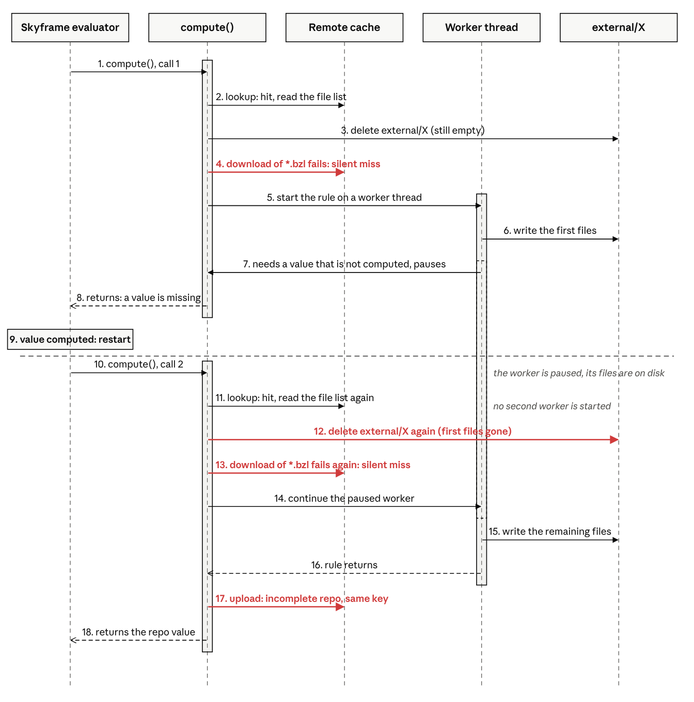
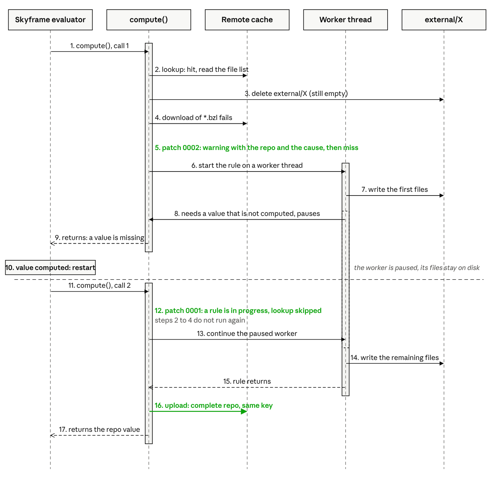

# RCA: remote repo contents cache poisoned by a re-entered lookup during a worker-thread fetch

|  |  |
| --- | --- |
| **Severity** | High. One client with write access breaks every build that uses the cache, and logs nothing that names the repo or the cache. |
| **Affected** | Bazel 8.8.x with `--experimental_remote_repo_contents_cache`. Not affected: 9.3.2, 10.0.0rc2, `master`. |
| **Components** | `RepositoryDelegatorFunction`, `StarlarkRepositoryFunction`, `RemoteExternalOverlayFileSystem`, `AbstractActionInputPrefetcher` |
| **Related** | [#31456](https://github.com/bazelbuild/bazel/issues/31456) (stabilization tracker). [#32179](https://github.com/bazelbuild/bazel/issues/32179) (the same `deleteTree`, a different victim). |

## Summary

A Bazel 8.8.2 client that cannot download the `.bzl` files of a cached repo replaces the cache entry of that repo with an incomplete one. Every other client that uses the cache then fails with `BUILD file not found in directory '' of external repository`.

The cause is the cache lookup. It runs again when Skyframe restarts the fetch. At that time the repo rule waits on its worker thread, and the lookup deletes the directory that the rule writes to. The rule then finishes in an emptied directory, and Bazel uploads the remaining files under the key of the complete repo.

The lookup does damage only when a download fails after the cache reported a hit. In production, a `zstd-jni` native library that could not load made every such download fail. A corrupted or missing blob has the same effect.

## Impact

- The poisoning client fails with `BUILD file not found` and logs no warning that names the repo or the cache.
- Every other client with the flag on fails with the same error. They share no local state with the poisoning client.
- The bad entry stays until a healthy client with write access runs `bazel fetch --force` for the repo. If the poisoning client builds first, it poisons the entry again.
- One poisoned entry for each reproducible repo rule that writes a `.bzl` or `REPO.bazel` file and restarts after a write. `http_archive` and other download-only rules are not affected.

## Background

Two mechanisms meet in this defect: the cache lookup, and the way Bazel restarts a repo rule.

### The cache lookup

With `--experimental_remote_repo_contents_cache`, Bazel stores the output directory of a reproducible repo rule in the remote cache. The key comes from the inputs of the rule. Before Bazel runs such a rule, it asks the cache for that key.

On a hit, Bazel does not run the rule. It deletes the local directory `external/<repo>` and keeps the list of the cached files in memory. It downloads only the files it needs immediately: the `.bzl` files and `REPO.bazel`. All other files download later, when something reads them. On a miss, Bazel runs the rule and uploads the directory that the rule wrote.

Two details matter here. The lookup deletes the directory before it knows whether the downloads succeed. And when a download fails, Bazel does not report an error. It treats the lookup as a miss and runs the rule.

### Restarts and the worker thread

A Skyframe function cannot wait. When it needs a value that Skyframe has not computed, the function returns, Skyframe computes the value, and Skyframe calls the function again from its first line. This is a restart. A repo rule causes one each time it uses something new. The usual case is the first label from a package that Bazel has not loaded.

In the past, a restart ran the rule again from scratch. Since Bazel 7, the rule runs on a worker thread. When the rule needs a missing value, the worker pauses in the middle of the rule, and only the function around it restarts. The second call of the function finds the paused worker and lets it continue. The rule keeps its variables and the files it already wrote.

So during a restart the rule is half done, its files are on disk, and the function that started it runs again from the top.

## Root cause

In 8.8.2 the cache lookup is at the top of that function, `RepositoryDelegatorFunction.compute()`, outside the worker. It runs on every call, and nothing tells it that a paused rule has files in the directory.

On a healthy client this does no harm. The lookup either hits, and the rule never starts, or it misses and does not touch the directory. The harmful case is a lookup that finds the entry, deletes the directory, and then cannot download the files. It ends as a miss, but the directory is gone.

The diagram shows one build on a client in that state. The cache has a complete entry for repo `X`, and the client cannot download its `.bzl` files.



In the first call (steps 1 to 8), the lookup finds the entry and deletes `external/X`. The directory is still empty, so nothing is lost. The download of the `.bzl` files fails, and the lookup ends as a miss without a log line. Bazel starts the rule on a worker thread. The rule writes its first files and then needs a value that Skyframe has not computed. The worker pauses, and `compute()` returns.

In the second call (steps 10 to 13), the lookup runs again. The cache still has the entry, so the lookup deletes `external/X` a second time. Now the directory holds the files that the rule wrote, and they are gone. The download fails again, and the lookup ends as a miss again.

After that (steps 14 to 18), `compute()` finds the paused worker and lets it continue. The rule does not know that its directory is empty. It writes its remaining files and returns. Bazel uploads the directory under the key of `X`, and the incomplete entry replaces the complete one. The build then fails, because `X` has no `BUILD` file.

The lookup is a check-then-act step that runs while the paused rule owns the directory. This is not a timing race. The rule decides where the restart occurs, so the same client loses the same files in every build. If the rule restarts more than once, each restart deletes the files written since the previous one.

## Triggers

The lookup does damage only if the download of a `.bzl` or `REPO.bazel` file fails after a hit. We found four causes.

1. The zstd native library cannot load. With `--remote_cache_compression`, Bazel decompresses each blob at or above `--experimental_remote_cache_compression_threshold` with `zstd-jni`, which copies `libzstd-jni.so` to `java.io.tmpdir` and loads it. A `noexec` temp mount, a platform mismatch or a repackaged Bazel without the library makes the load fail. The `UnsatisfiedLinkError` goes into `java.log` only. The failure repeats on every build, which is why it surfaced first. This is the production case. Smaller files download normally, and a file list above the threshold fails before the deletion, which does no harm.
2. A CAS blob whose content does not match its digest. The download fails the digest check. Verified against bazel-remote and BuildBuddy OSS. The regression test uses this trigger.
3. A `.bzl` blob missing from the CAS, on a server that returns the entry and does not check that its blobs exist. Verified with bazel-remote `--disable_grpc_ac_deps_check`. bazel-remote by default, BuildBuddy and Bazel's test worker reject such an entry.
4. Any other download error that outlasts the retries. Not tested.

All four share the root cause and the fix.

## Scope

A repo is at risk when its rule is reproducible, writes at least one `.bzl` or `REPO.bazel` file, and restarts after it writes a file. The client must also have write access to the cache. With `--experimental_worker_for_repo_fetching=off`, a restart runs the rule again from scratch, which writes every file again. That flag is the interim workaround.

The poisoned entry keeps the files that the rule wrote after its last restart. In a repo rule, `rctx.template`, `rctx.read`, `rctx.path` and `rctx.symlink` cause a restart when they use the first label from a new package. `rctx.getenv` for a new variable and `rctx.watch` on a new path also cause one. `rctx.execute` alone does not.

In the production rule, the root templates and the `__config__` templates are in two packages. The first `__config__` template causes a restart after six writes. The first six files are lost, and the three `__config__` files survive. The repro mirrors this with six files and a restart after three writes.

To find the restart point in a rule, run one fetch with `--experimental_worker_for_repo_fetching=off` and a `print()` before each write. The prints before the restart point appear once more than the prints after it.

## Detection

- For the zstd trigger: `grep -l zstd-jni $(bazel info output_base)/java.log*` on each client with cache write access. Other triggers leave no client-side trace in 8.8.2. Patch 0002 adds one.
- In the cache server log, all in one build: one read of the entry for a repo key (`GetActionResult`), then two or more reads of the same file list (the Tree digest), then one write of the entry (`UpdateActionResult`).
- A `repo_contents` Tree with no `BUILD` or `BUILD.bazel` at its root for a repo whose rule writes one. `tools/inspect_cache.py tree` prints Trees from bazel-remote.

## Reproduction

`repro_zstd.sh` runs three Bazel clients against one `bazel-remote`. The test repo `@x` writes six files: `BUILD.bazel`, `defs.bzl` (3730 bytes), `metadata.json`, `__config__/BUILD.bazel`, `__config__/defs.bzl` (3250 bytes), `package.json`. The first label from `@tpl//__config__` causes a restart after the third write. The poisoner breaks zstd with `--host_jvm_args=-DZstdNativePath=<not a library>`. With `NOEXEC_DIR` set, it uses `-DZstdTempFolder=<noexec mount>`.

| Client | Result |
| --- | --- |
| healthy | fetches `@x`, uploads the good entry with all six files |
| poisoner | fails with `BUILD file not found`, replaces the entry with `__config__/BUILD.bazel`, `__config__/defs.bzl`, `package.json`, `REPO.bazel` |
| consumer | fails with `BUILD file not found` |

Compare the two Trees in the report to see which files the restart cut.

To confirm the cause, change one condition at a time. With each of these changes the poisoner uploads a complete repo, and the consumer has a cache hit:

- `BREAK_ZSTD=0`: the downloads succeed, so the lookup is a clean hit.
- A `.txt` file in place of the `.bzl`, or a `defs.bzl` below the compression threshold: the lookup downloads no file that fails.
- A rule without a label from a new package: the rule does not restart.
- `POISONER_FLAGS=--experimental_worker_for_repo_fetching=off`: the restart runs the rule again from scratch. This is also the interim workaround.

The bazel-remote log of the poisoner shows one `AC GET`, three reads of the good Tree (first lookup plus two restarts), and one `AC PUT`. It shows no read of the `.bzl` files. Verified with `bazel-8.8.2-linux-x86_64` and bazel-remote 2.6.4. BuildBuddy OSS 2.323.0 gave the same result on an earlier workspace.

## Affected versions

9.3.2, 10.0.0rc2 and `master` are not affected. The lookup still deletes the directory first, but it moved into the worker (`RepositoryFetchFunction.computeInternal()`), and a missing value blocks the worker and does not restart the function. The lookup thus runs once per fetch. A failed download after a hit still costs a local fetch and logs nothing, but the upload is complete.

## Resolution

Two patches against 8.8.2 are in `bazel-rrcc-poisoning/patches/`. Patch 0001 stops the lookup from running again after the rule starts. It closes the defect on its own, and 9.x already has this behavior. Patch 0002 prints a warning when a download fails after a hit. It applies to `master` as well.

The diagram shows the same build with both patches. The first call is the same, except for the warning (step 5). In the second call, the lookup does not run (step 12), so the directory keeps the first files. The rule finishes, and the upload is complete.



### Patch 0001: skip the lookup during a worker fetch

`compute()` already skips the lookup after the rule finishes. Patch `0001-repo-fetch-skip-remote-lookup-once-worker-started.patch` extends that to the time while the worker runs or waits. It adds `isFetchInProgressOrDone` to `RepositoryFunction`, and `RepositoryDelegatorFunction` uses it as a guard in front of the lookup:

```java
if (remoteRepoContentsCache != null && !handler.isFetchInProgressOrDone(env)) {
  ... lookupCache ...
}
```

### Patch 0002: report a failed injection

Patch `0002-rrcc-report-failed-injection-instead-of-silent-miss.patch` keeps the original download error and reports it through the existing warning path for failed lookups. Bazel then fetches locally, as before. On the poisoning client the warning reads:

```
WARNING: Remote repo contents cache lookup failed for @@+_repo_rules2+x: ... found a cache entry but failed to
download 2 of 3 prefetched file(s); treating as a cache miss and fetching locally (download error:
java.lang.UnsatisfiedLinkError: ...)
```

### Regression test

Patch `0003-rrcc-regression-test-lookup-during-worker-fetch.patch` adds `testLookupNotRepeatedWhileWorkerFetchIsRunning` to `src/test/py/bazel/bzlmod/remote_repo_contents_cache_test.py`. The rule writes `BUILD`, reads a label from a second repo (the restart), and writes `defs.bzl`. After the first build, the test corrupts the `defs.bzl` blob in the test worker's CAS in place, so the AC check passes and the download fails. After `clean --expunge`, the build must succeed, print the warning, and leave a complete repo on disk. The test then restores the blob, expunges again, and checks that a clean client has a cache hit. Without patch 0001 the second build fails with `BUILD file not found`. The test uses a corrupted blob because the test worker does not support compression. Both failures take the same path.

### Verification

The patches apply to the 8.8.2 tag. `build_bazel.sh` builds Bazel from source with them. With that Bazel, `repro_zstd.sh` gives NOT REPRODUCED. The poisoner reads the Tree once, prints the warning above, and uploads the complete Tree again. The consumer has a cache hit. `run_regression_test.sh` runs the test.

## Alternatives considered

- Stop mapping download errors to `CacheNotFoundException` in the prefetcher. Action rewinding needs that mapping, and `injectRemoteRepo` would still delete the directory on its `IOException` path.
- Memoize the failed injection in `LookupState`. Prevents the second deletion but keeps the first, and leaves the fetch in a directory another caller can delete.
- Turn off worker-thread fetching by default in 8.x. Fixes the symptom at the cost of a full rerun of every rule on each restart, and 9.x no longer has the non-worker path.

## References

Bazel 8.8.2 (tag `8.8.2`):

- [RepositoryDelegatorFunction.java](https://github.com/bazelbuild/bazel/blob/8.8.2/src/main/java/com/google/devtools/build/lib/rules/repository/RepositoryDelegatorFunction.java): the lookup on each call (237, 273), `shouldUseCachedRepos` and `wasJustFetched` (549, 551), the upload in `addToCache` (338)
- [RemoteRepoContentsCacheImpl.java](https://github.com/bazelbuild/bazel/blob/8.8.2/src/main/java/com/google/devtools/build/lib/remote/RemoteRepoContentsCacheImpl.java): `LookupState` memoizes the entry, not the result of the injection (243, 257)
- [RemoteExternalOverlayFileSystem.java](https://github.com/bazelbuild/bazel/blob/8.8.2/src/main/java/com/google/devtools/build/lib/remote/RemoteExternalOverlayFileSystem.java): `injectRemoteRepo` (209), the deletion (212), the silent miss (231 to 234), `shouldPrefetch` (430)
- [AbstractActionInputPrefetcher.java](https://github.com/bazelbuild/bazel/blob/8.8.2/src/main/java/com/google/devtools/build/lib/remote/AbstractActionInputPrefetcher.java): download errors become `CacheNotFoundException` (704 to 714)
- [StarlarkRepositoryFunction.java](https://github.com/bazelbuild/bazel/blob/8.8.2/src/main/java/com/google/devtools/build/lib/bazel/repository/starlark/StarlarkRepositoryFunction.java): `setupRepoRootBeforeFetching` with a worker (110 to 114), boundary files (391)

Newer Bazel: [RepositoryFetchFunction.java on master](https://github.com/bazelbuild/bazel/blob/master/src/main/java/com/google/devtools/build/lib/bazel/repository/RepositoryFetchFunction.java) (181, 284).

Other: [bazel-remote](https://github.com/buchgr/bazel-remote) 2.6.4, [BuildBuddy](https://github.com/buildbuddy-io/buildbuddy) OSS 2.323.0, [zstd-jni 1.5.6-9, Native.java](https://github.com/luben/zstd-jni/blob/v1.5.6-9/src/main/java/com/github/luben/zstd/util/Native.java).
